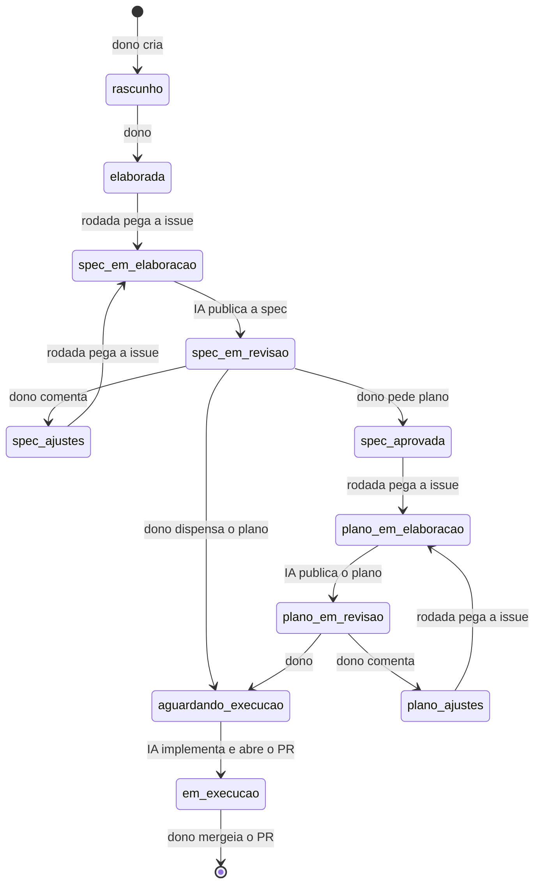

# Contribuindo

Guia de quem mexe no código. Instalar e usar a ferramenta está no
[README.md](README.md); o porquê do sistema, em [docs/decisoes/](docs/decisoes/README.md);
como escrever código e teste, em [docs/padroes/codigo.md](docs/padroes/codigo.md) e
[docs/padroes/testes.md](docs/padroes/testes.md).

## Setup de desenvolvimento

Requisitos: Python 3.14, [uv](https://docs.astral.sh/uv/), git, Docker e `make`.

```bash
make setup         # uv sync --all-extras, cria .env.development, instala o pre-commit
make db-dev        # sobe o Postgres de desenvolvimento (porta 5434)
make migrate-dev   # alembic upgrade head contra o .env.development
```

Para rodar o CLI contra o banco de desenvolvimento, passe `--env development`:

```bash
./.venv/bin/motor --env development verificar 13.34.0 --repo meu-repo
```

## Produção é o padrão; desenvolvimento é explícito

CLI, `compose.yml` e Alembic leem `.env` — **produção**, porta 5433. O ambiente de
desenvolvimento (`.env.development`, porta **5434**) só entra quando pedido: alvos
`-dev` do Makefile e `--env development` no CLI.

A suíte de testes não usa nenhum dos dois. Os testes de integração sobem um Postgres
**efêmero** (testcontainers), migram e o derrubam no fim; a URL vem do container, nunca
do ambiente, então o `TRUNCATE` dos testes não alcança banco nenhum seu. Sem Docker,
esses testes pulam — e pulado não é verde. Detalhes em
[docs/padroes/testes.md](docs/padroes/testes.md#ambiente-e-integração).

O banco de desenvolvimento serve para usar o CLI à mão sem tocar produção.

## Verificações

```bash
make check   # ruff format --check, ruff check, mypy, pytest -rs
make fmt     # formata e aplica os fixes automáticos do ruff
```

`make check` roda os mesmos alvos, na mesma ordem, que o CI
([.github/workflows/ci.yml](.github/workflows/ci.yml)): verde aqui é verde lá. O `-rs`
do pytest lista o motivo de cada skip — confira se a integração rodou.

O `make setup` instala o [pre-commit](.pre-commit-config.yaml): ruff (format e check) e
mypy a cada commit. O pytest fica de fora do hook; rode `make check` antes de abrir o PR.

## Armadilhas do ambiente

| Sintoma | Causa e saída |
| --- | --- |
| `uv run pytest` morre na coleta com `SyntaxError: future feature annotations is not defined` | Um `VIRTUAL_ENV` de outro projeto (Python antigo) vazou para o shell e o `uv` o prefere ao `.venv`. Não é erro de código. Use `make` (ele faz `unexport VIRTUAL_ENV`), ou `unset VIRTUAL_ENV`, ou chame `./.venv/bin/python -m pytest` (idem `mypy`, `ruff`, `alembic`). Sem `.venv`: `unset VIRTUAL_ENV; uv sync --all-extras`. |
| `docker compose up -d` subiu, mas não é o banco de desenvolvimento | Sem `--env-file`, o compose lê `.env` (produção, porta 5433). Desenvolvimento é `make db-dev`, ou `docker compose --env-file .env.development up -d --wait`. |
| `alembic upgrade head` migrou o banco errado | O `load_dotenv()` do Alembic não sobrescreve variável já presente no ambiente — e sem nada exportado lê `.env`. Use `make migrate-dev`, ou exporte antes: `set -a; . ./.env.development; set +a; ./.venv/bin/python -m alembic upgrade head`. |

## Fluxo

1. **Trabalho nasce na issue.** A spec vai no corpo da issue; o plano, em comentário
   nela. A issue avança pelo [ciclo da issue](#ciclo-da-issue).
2. **Branch e PR.** A `main` é protegida: toda mudança entra por PR, e o merge exige os
   checks `ruff format`, `ruff check`, `mypy` e `pytest` verdes — para todos, dono
   incluído.
3. **O PR descreve o que foi feito** — e o desvio do plano, quando houver — e fecha a
   issue com `Closes #N`. O [template](.github/pull_request_template.md) traz o
   checklist. O Claude revisa o PR quando ele abre, e `@claude review`, comentado pelo
   dono, pede uma nova revisão; a revisão comenta e não bloqueia, e o merge continua
   humano. Quem ajusta o PR por causa de um comentário da revisão responde na thread
   (o que mudou e em qual commit, ou por que não mudou) e a marca como resolvida quando
   o ajuste a encerra. Resposta escrita por IA termina com a linha
   `🤖 _Resposta do Claude Code_`.

## Ciclo da issue

A issue é elaborada, recebe spec, a spec é revisada, recebe plano (quando precisa), o
plano é revisado, e só então é executada. O estado fica nas labels `estado:`; o dono
dispara a rodada com `/rodada [milestone|#N]`, que avança cada issue um passo até o
próximo portão humano. Como a rodada trabalha está em
[.claude/skills/rodada/](.claude/skills/rodada/SKILL.md).



As labels `estado:` são exclusivas entre si. Ao aplicar uma, o orquestrador remove a
anterior.

| Label | Quem aplica | Significado |
| --- | --- | --- |
| `estado:rascunho` | dono, ao criar | em elaboração; a IA faz triagem |
| `estado:elaborada` | **dono** | entra no fluxo; o agente escreve a spec |
| `estado:spec-em-elaboração` | IA | agente escrevendo ou revisando a spec; serve de trava |
| `estado:spec-em-revisão` | IA | spec no corpo, já revisada pela IA, esperando o dono |
| `estado:spec-ajustes` | **dono** (+ comentário) | o agente revisa a spec com base nos comentários |
| `estado:spec-aprovada` | **dono** | o agente escreve o plano |
| `estado:plano-em-elaboração` | IA | agente escrevendo ou revisando o plano; serve de trava |
| `estado:plano-em-revisão` | IA | plano em comentário, já revisado pela IA, esperando o dono |
| `estado:plano-ajustes` | **dono** (+ comentário) | o agente revisa o plano |
| `estado:aguardando-execução` | **dono** | pode executar, com ou sem plano |
| `estado:em-execução` | IA | agente trabalhando ou PR aberto; serve de trava |

Duas labels ficam fora da máquina de estados e convivem com as `estado:`:

| Label | Quem aplica | Significado |
| --- | --- | --- |
| `ia:elaborada` | IA | na triagem, a IA considera a issue pronta para entrar no fluxo |
| `ia:travada` | IA | um passo falhou; as rodadas pulam a issue até o dono remover a label |

Regras gerais:

- Issue aberta sem nenhuma label `estado:` conta como `estado:rascunho`.
- Issue com bloqueio aberto (`blocked_by`) não avança, seja qual for o estado.
- Ao aprovar a spec, o dono decide o plano pela label que aplica: `spec-aprovada` pede
  plano, `aguardando-execução` dispensa.
- A issue fecha no merge do PR, via `Closes #N`.
- Os estados em andamento (`spec-em-elaboração`, `plano-em-elaboração`, `em-execução`)
  são travas: a rodada só os aplica no momento de despachar o agente, e duas rodadas
  nunca trabalham na mesma issue. Trava parada há mais de 2 horas aparece no relatório
  da rodada; quem a solta é o dono.
