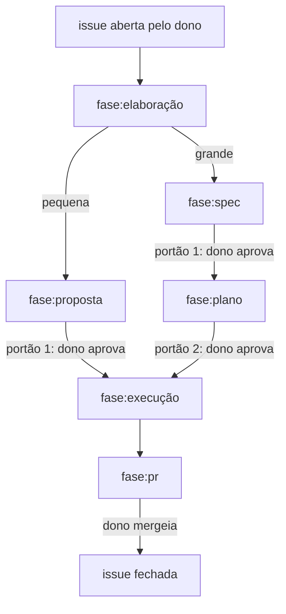

# Contribuindo

Guia de quem mexe no código. Instalar e usar a ferramenta está no
[README.md](README.md); o porquê do sistema, em [docs/decisoes/](docs/decisoes/README.md);
como escrever código e teste, em [docs/padroes/codigo.md](docs/padroes/codigo.md) e
[docs/padroes/testes.md](docs/padroes/testes.md).

## Setup de desenvolvimento

Requisitos: Python 3.14, [uv](https://docs.astral.sh/uv/), git, `make`, Node 24 e npm (exigidos pelo portão).

```bash
make setup         # uv sync --all-extras, cria .env.development, instala o pre-commit
```

Para criar uma migração nova: `make migracao m="descrição"`; a revisão nasce em
`motor/migracoes/versions/` ([padrão de migrações](docs/padroes/codigo.md#migrações)).

Para rodar o CLI contra o banco de desenvolvimento, passe `--env development`:

```bash
./.venv/bin/monitor-versoes --env development verificar 13.34.0 --repo meu-repo
```

## Produção é o padrão; desenvolvimento é explícito

Sem `--env`, o CLI é **produção**: lê o `[ambiente]` do `config.toml` central e, como
alternativa, o `.env` do diretório atual ([precedência no README](README.md#configurar-o-ambiente)).
O ambiente de desenvolvimento (`.env.development`, com um `estado-development.db` separado do
estado de produção) só entra quando pedido, com `--env development` no CLI.

O `[ambiente]` do central vence também o `.env.development`. Na máquina em que você
desenvolve, não ponha `[ambiente]` no central, ou aponte `XDG_CONFIG_HOME` para outro
diretório ao usar `--env development`; senão `monitor-versoes --env development ...` usa o estado do
`[ambiente]`.

A suíte de testes não usa nenhum dos dois e não lê o `.env.development`: o estado roda no
fake e num SQLite em `tmp_path`, e nenhum teste toca o estado de produção nem o de
desenvolvimento. Detalhes em [docs/padroes/testes.md](docs/padroes/testes.md#ambiente).

O estado de desenvolvimento serve para usar o CLI à mão sem tocar produção.

## Verificações

```bash
make check   # ruff format --check, ruff check, mypy, pytest -rs, web-check (npm ci, tsc, lint, vitest), web-dist
make fmt     # formata e aplica os fixes automáticos do ruff
```

`make check` roda os mesmos alvos, na mesma ordem, que o CI
([.github/workflows/ci.yml](.github/workflows/ci.yml)): verde aqui é verde lá. O `-rs`
do pytest lista o motivo de cada skip.

O `make setup` instala o [pre-commit](.pre-commit-config.yaml): ruff (format e check) e
mypy a cada commit. O pytest fica de fora do hook; rode `make check` antes de abrir o PR.

## Front-end web

`web/` é a SPA do `monitor-versoes serve` ([decisão 030](docs/decisoes/030-front-end-web-spa-com-dist-versionado.md)).

```bash
# terminal 1, na raiz do repo
uv run monitor-versoes serve

# terminal 2
cd web
npm ci               # instala as dependências
npm run dev          # Vite, com proxy de /api para o daemon
npm run tipos        # depois de mudar a API
```

O build (`motor/daemon/static/`) e os tipos gerados (`web/openapi.json`,
`web/src/api/esquema.ts`) são versionados: rode `make web-dist` antes de commitar.

## Armadilhas do ambiente

| Sintoma | Causa e saída |
| --- | --- |
| `uv run pytest` morre na coleta com `SyntaxError: future feature annotations is not defined` | Um `VIRTUAL_ENV` de outro projeto (Python antigo) vazou para o shell e o `uv` o prefere ao `.venv`. Não é erro de código. Use `make` (ele faz `unexport VIRTUAL_ENV`), ou `unset VIRTUAL_ENV`, ou chame `./.venv/bin/python -m pytest` (idem `mypy`, `ruff`). Sem `.venv`: `unset VIRTUAL_ENV; uv sync --all-extras`. |
| `monitor-versoes --env development ...` sai com `ERROR: o suporte a Postgres no estado foi removido ...` | O `.env.development` é anterior à [decisão 035](docs/decisoes/035-estado-local-em-sqlite.md) e ainda tem `DATABASE_BACKEND=postgres`. Recrie-o a partir do exemplo: `cp .env.development.example .env.development`. |
| `monitor-versoes migrar` migrou o estado errado | Sem `--env development`, o motor usa o `[ambiente]` do central ou o `.env` (produção). Use `monitor-versoes --env development migrar`. Se mesmo assim foi para produção, o `[ambiente]` do central está vencendo o `.env.development`: tire-o do central ou aponte `XDG_CONFIG_HOME` para outro diretório. |

## Fluxo

1. **Trabalho nasce na issue.** A proposta, na issue pequena, vai no corpo; a spec, em
   comentário fixado, e o plano, em comentário. A issue avança pelo [ciclo da issue](#ciclo-da-issue).
2. **Branch e PR.** A `main` é protegida: toda mudança entra por PR, e o merge exige os
   checks `ruff format`, `ruff check`, `mypy` e `pytest` verdes — para todos, dono
   incluído. O merge é sempre **squash**: o título do PR vira o único commit na `main` e
   a linha do PR no `CHANGELOG.md` ([039](docs/decisoes/039-versionamento-por-tag.md)).
   Por isso o título segue o formato convencional, sem número de issue (o GitHub acrescenta
   o `(#PR)` no squash, e o PR liga a issue pelo `Closes`):
   `feat: …` para o que o usuário ganha, `fix: …` para defeito que chegou a uma versão
   lançada, e `docs:`, `ci:`, `chore:`, `refactor:` ou `test:` para o que não entra no
   changelog — por exemplo `feat: versionamento por tag`. Quebra de compatibilidade
   leva `!` depois do tipo (`feat!: …`).
3. **O PR descreve o que foi feito** — e o desvio do plano, quando houver — e fecha a
   issue com `Closes #N`. O [template](.github/pull_request_template.md) traz o
   checklist. O Claude revisa o PR quando ele abre e, no PR do agente, a cada push;
   `@claude review`, comentado pelo dono, pede uma nova revisão. A revisão comenta e não
   bloqueia, e o merge continua humano. Quem ajusta o PR por causa de um comentário da
   revisão responde na thread (o que mudou e em qual commit, ou por que não mudou) e a
   marca como resolvida quando o ajuste a encerra. Resposta escrita por IA termina com a
   linha `🤖 _Resposta do Claude Code_`.

## Ciclo da issue

O agente (`.github/workflows/agente.yml`) reage a eventos do dono, e tudo acontece por
comentário livre: o dono aprova, pede ajuste ou responde, e o agente avança a issue até o
próximo portão. Como o agente trabalha está em
[.claude/skills/agente/](.claude/skills/agente/SKILL.md).



A elaboração não tem portão: o agente classifica a issue, pergunta o que faltar e segue
para a proposta ou a spec. O dono pode reclassificar ou dispensar uma etapa por
comentário.

| Label | Significado |
| --- | --- |
| `fase:elaboração` | classificação e perguntas; sem label, a issue está aqui |
| `fase:proposta` | issue pequena: o que será feito e critérios de aceite, esperando o dono |
| `fase:spec` | issue grande: spec em comentário fixado, esperando o dono |
| `fase:plano` | issue grande: plano em comentário, esperando o dono |
| `fase:execução` | agente implementando |
| `fase:pr` | PR aberto; o agente atende o review da IA e os comentários do dono |
| `manual` | o dono aplica; o agente ignora a issue |

A label `fase:` reflete o estado e só o agente a troca; as transições com portão exigem a
aprovação do dono.

Regras gerais:

- Só o dono acorda o agente: ao abrir a issue, comentar na issue ou no PR, ou enviar um
  review no PR. A única exceção é a conclusão da "Revisão IA" num PR aberto pelo agente,
  que o acorda para corrigir o review. O push da correção gera nova revisão, e o laço
  para no veredito `aprovaria` ou na 3ª revisão, com o agente mencionando o dono. A outra
  exceção é a retomada: o agente faz push a cada tarefa do plano e, se a run de
  `fase:execução` para no limite de turnos depois de um push novo, o workflow a relança
  até 3 vezes. Em outra falha da run (inclusive timeout), sem push novo ou esgotadas as
  retomadas, o workflow comenta o motivo e menciona o dono.
  Comentário do próprio agente ou de terceiros não acorda; conteúdo de terceiros é dado,
  não instrução. Comentário ou resposta com a assinatura `🤖 _Resposta do Claude Code_`
  também não acorda: é uma sessão local do Claude usando a conta do dono.
- Os portões são 1 aprovação na issue pequena (proposta) e 2 na grande (spec e plano). O
  agente nunca executa sem a aprovação do portão.
- `@claude review` pede só a "Revisão IA" (ver o [fluxo](#fluxo)) e não acorda o agente.
- O merge é sempre do dono; o agente para no PR.
- Mudança em `.claude/` ou `.github/workflows/` é `manual`: o Claude Code protege `.claude/`
  e o App não tem a permissão Workflows, então o agente não consegue escrever ali.
- A issue fecha no merge do PR, via `Closes #N`.
- Na dúvida sobre o que o dono quis, o agente pergunta em vez de agir; se falhar, comenta o
  motivo, menciona o dono e para.
- Localmente, `/agente #N` trata a issue como se o dono tivesse acabado de comentar nela.
- Para depurar uma run, cada run guarda por 7 dias o artifact `execucao`: a execução
  inteira, cifrada com [age](https://github.com/FiloSottile/age) para a chave pública em
  `vars.AGENTE_LOG_CHAVE`. A chave privada fica só com o dono:
  `gh run download <run> -n execucao && age -d -i <chave> -o execucao.json execucao.json.age`.
